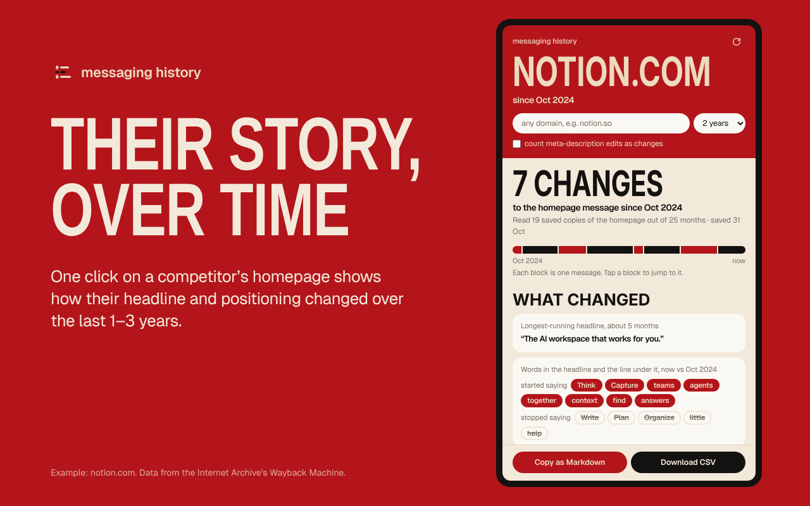
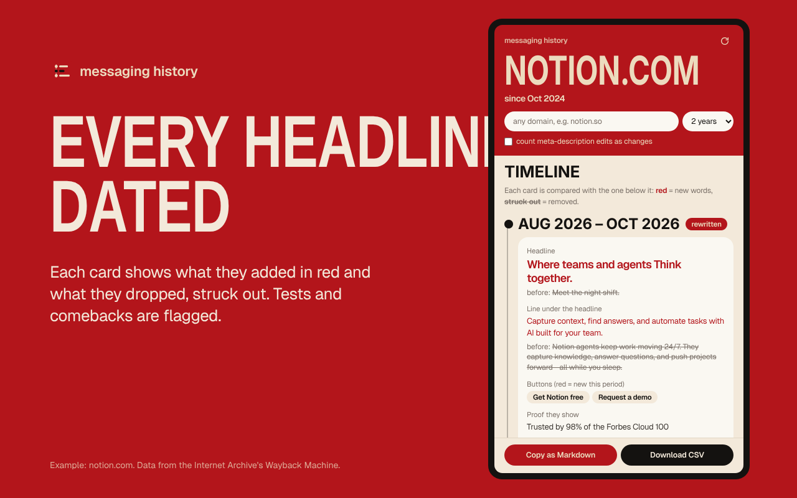
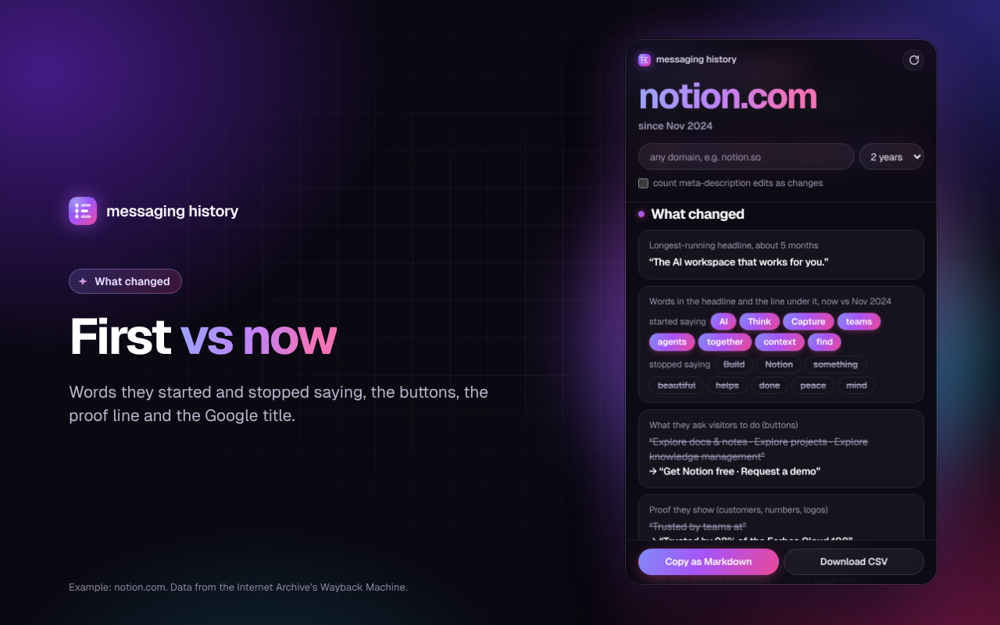

# Messaging History

A Chrome extension. Open a competitor's homepage, click the icon, and a side panel shows how their headline, subheadline, CTAs and meta description changed over the last 1, 2 or 3 years, as a timeline with word-level changes marked.

Free to run: the data comes from the Internet Archive's Wayback Machine. There is no server and no API key.

## Install (developer mode)

1. Open `chrome://extensions`.
2. Turn on **Developer mode** (top right).
3. Click **Load unpacked** and pick this folder (`messaging-history`).
4. Pin the icon (puzzle piece → pin).
5. Open any competitor's homepage and click the icon.

## How it works

- Lists one archived capture per month (Wayback CDX API).
- Reads every third month, then reads the months between any two samples that differ, to date each change. That's usually 10–15 pages instead of 25.
- The archive blocks bursts as bot traffic, so the panel reads one page every 4 seconds. A first run takes about 1–2 minutes. Results are cached for 7 days, so reopening is instant.
- The live page is read too when you click the icon on the homepage itself. If it differs from the last capture, it shows as "Live now".
- **What changed** block on top: longest-running headline, words they started and stopped saying, how the buttons changed, the proof line (customers, numbers) and the Google page title, first vs now.
- Saved copies in another language (a country version the crawler happened to get) are hidden, with a note saying how many.
- A message seen in one month only, or one that comes back later, is marked as a likely test, with a sentence explaining why.
- Export: **Copy as Markdown** (for a doc or Slack) or **Download CSV** (every capture read).

## Screenshots

Example data: notion.com, from the Wayback Machine.

## Limits

- Sites that draw everything with JavaScript save almost empty HTML. For those, the panel falls back to the og:title or the page title.
- A short A/B test between two sampled months can be missed.
- Titles use Helvetica Neue Condensed Bold, which every Mac has. Other systems fall back to Arial Narrow.

## Files

- `manifest.json`, `background.js`: toolbar click opens the side panel
- `sidepanel.html|css|js`: the panel
- `lib/extract.js`: finds headline, subheadline and CTAs in a page
- `lib/wayback.js`: archive requests, pacing, back-off
- `lib/diff.js`, `lib/eras.js`: word diff and grouping months into eras
- `fonts/`: Geist (SIL Open Font License, see `fonts/OFL.txt`)
- `screenshots/`: Chrome Web Store images

## Privacy

No server, no tracking. The only request goes to web.archive.org. See [PRIVACY.md](PRIVACY.md).
